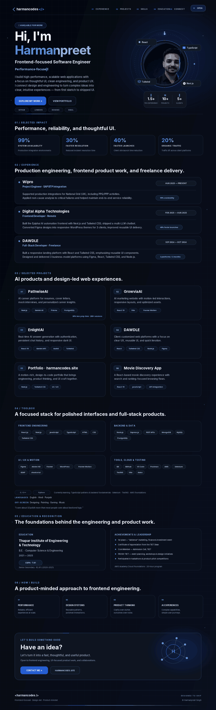

  <a href="https://www.harmancodes.site/">Portfolio</a> ·
  <a href="https://github.com/Harman-khurmi">GitHub</a> ·
  <a href="https://www.linkedin.com/in/harmankhurmi/">LinkedIn</a> ·
  <a href="https://www.behance.net/harmankhurmi">Behance</a> ·
  <a href="https://www.figma.com/@harmankhurmi">Figma</a> ·
  <a href="mailto:harmankhurmi365@gmail.com">Email</a>

Source artwork: <code>assets/harman-profile.svg</code>. GitHub displays SVGs without inline animation, so the profile preview uses a lightweight animated GIF to preserve motion.

